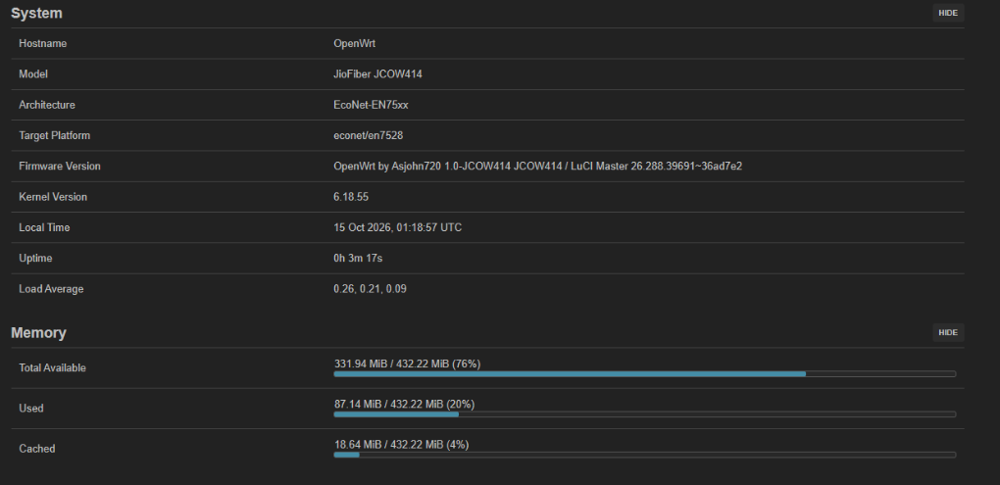

# JioFiber Router JCOW414 OpenWrt

[](https://openwrt.org)
[](#hardware-specifications)
[](https://kernel.org)
[](#hardware-specifications)
[](TESTING.md)
[](#dual-bank-failsafe--rollback)
[](https://openwrt.org/toh/sercomm/jcow414)
[](LICENSE)

An unofficial, fully working community OpenWrt port for the **Sercomm JioFiber JCOW414 / JCO4032** router (powered by the **EcoNet / Airoha EN7528HU** platform).

This repository provides the complete **Device Tree Source (`.dts`)**, build recipes, automated 1-click root patch tools, pre-compiled flashable `.trx` binaries, and step-by-step flashing guides to unlock your JCOW414 router and run modern OpenWrt with LuCI web administration.

> 📖 **Official Hardware Documentation:** [OpenWrt Table of Hardware: Sercomm JCOW414](https://openwrt.org/toh/sercomm/jcow414)
>
> 🧪 **Hardware Verification Report:** 100% verified on real hardware (Dual-Band Wi-Fi, Gigabit LAN, USB 3.0, and Flash persistence). Read the comprehensive testing matrix in [TESTING.md](TESTING.md).
>
> 📺 **Companion Project:** Have a Reliance Jio Set-Top Box (JHSB200 / JHSC200)? Unlock wireless ADB, remove ads, and install custom launchers using [Jio Set-Top Box Unlock](https://github.com/Asjohn720/jiosetupbox-jhsb200-unlock).



---

## ⚡ Quick Flashing Guide (No Disassembly Required)

You do **not** need to open your router or solder serial wires. Flashing is performed entirely over the network using the stock web panel and root Telnet shell.

---

### Step 1: Gain Root Access (Automated 1-Click Method)

> [!NOTE]
> **Why do this?** Modern Jio firmware versions (R2.41 / R2.52) lock the root account with randomized passwords. Downgrading to R2.15 allows us to decrypt the router's configuration file, inject a command that launches a root Telnet server, and set our own known password (`password`).

#### 1.1 Downgrade Router to R2.15
1. Download these two official signed firmware files to your computer:
   * **Firmware Image:** [`SRCMTF1_JCOW414_R2.15.img`](https://raw.githubusercontent.com/gpsarathy/JioFiber-Home-Gateway/master/Firmwares/JCOW414/2.15/SRCMTF1_JCOW414_R2.15.img) (or via [Jio OTA Mirror](http://fota.slv.fxd.jiophone.net/ONT/Sercomm/JCOW414/SRCMTF1_JCOW414_R2.15.img))
   * **Signature File:** [`SRCMTF1_JCOW414_R2.15.sig`](https://raw.githubusercontent.com/gpsarathy/JioFiber-Home-Gateway/master/Firmwares/JCOW414/2.15/SRCMTF1_JCOW414_R2.15.sig) (or via [Jio OTA Mirror](http://fota.slv.fxd.jiophone.net/ONT/Sercomm/JCOW414/SRCMTF1_JCOW414_R2.15.sig))
2. Open your browser and go to `http://192.168.29.1` (Default login: `admin` / `Jiocentrum` or your Wi-Fi password).
3. Navigate to: **Administrator** &rarr; **Maintenance** &rarr; **Firmware Upgrade**.
4. Select both files (`.img` and `.sig`) and click **Proceed**. Wait ~2–3 minutes while the router reboots into R2.15.

#### 1.2 Download Your Config Backup
1. After reboot, log back in to `http://192.168.29.1`.
2. Go to: **Administrator** &rarr; **Maintenance** &rarr; **Backup/Restore**.
3. Click the **Backup** button. Your browser downloads a file named like `RSVXXXXXXXXXXX_JCOW414.enc`.

#### 1.3 Run 1-Click Auto-Patch Script
To inject the root payload into your downloaded backup:

* **On Windows (1-Click Standalone):**  
  Download [`JioFiber_Universal_Root_Unlocker_For_Windows.bat`](tools/JioFiber_Universal_Root_Unlocker_For_Windows.bat).  
  👉 **Drag & drop** your downloaded `RSV..._JCOW414.enc` file directly onto the `.bat` file (or double-click it!).

* **On Linux / macOS (Python):**  
  ```bash
  python3 tools/JioFiber_Universal_Root_Unlocker_For_mac_linux.py
  ```

*(Advanced users can also manually decrypt and re-encrypt using OpenSSL with passphrase `"BE F2 26 75 7C B1 49 CB 04 CD CA 84 DC 5B E9 55"`).*

This instantly creates **`backup_root_ready.enc`** in your folder!

#### 1.4 Upload Modified Backup & Connect
1. In the router web panel, go to **Maintenance** &rarr; **Backup/Restore**.
2. Under **Restore**, choose `backup_root_ready.enc` and click **Restore**.
3. > [!TIP]
   > **Normal & Expected Notice:** The web UI will show:  
   > `"Failed to update configuration (checksum error)"`  
   > **Do NOT panic!** The router executed your injected payload in memory as root *before* checking the checksum. Telnet root shell is now active!
4. Open your terminal (or PuTTY) and connect via Telnet:
   ```bash
   telnet 192.168.29.1 23
   ```
   * **Username:** `root`
   * **Password:** `password`

You now have full root access to your JCOW414 router! 🎉

---

### Step 2: Download & Flash OpenWrt Factory Image (.trx)

Pre-built binaries are available in [`openwrt/Build/`](openwrt/Build/) and under [GitHub Releases](https://github.com/Asjohn720/jiofiber-jcow414-openwrt/releases):

| Firmware Binary | Size | SHA-256 Checksum |
| :--- | :--- | :--- |
| **`openwrt-jiofiber_jcow414_v1.1.trx`** *(Recommended)* | ~13.8 MB | `43112eacecdcea64bb213520df50df18cbcd68fc4682932807e915e97883feb2` |
| **`openwrt-jiofiber_jcow414_v1.0.trx`** | ~13.8 MB | `0b0f45956c85d046bf2c77257f9d39bf936f54e20a5accaba752f64563a39c6d` |

1. Download the latest `.trx` factory image (`openwrt-jiofiber_jcow414_v1.1.trx`).
2. On your PC, open a terminal in the folder where you saved the `.trx` file and start a local HTTP server:
   ```bash
   python -m http.server 8000
   ```
3. In your router's Telnet shell (`root@192.168.29.1`), download the firmware into RAM (`/tmp`):
   ```sh
   cd /tmp
   # Replace <YOUR_PC_IP> with your computer's actual LAN IP (e.g., 192.168.29.x)
   wget http://<YOUR_PC_IP>:8000/openwrt-jiofiber_jcow414_v1.1.trx -O openwrt.trx
   ```
4. Flash the factory image into **Bank 1 (`tclinux`)**:
   > [!IMPORTANT]
   > The `-f` force flag is **strictly mandatory** to bypass the stock Broadcom/EcoNet TRX header signature validation:
   ```sh
   mtd -f write /tmp/openwrt.trx tclinux
   ```

---

### Step 3: Switch Active Boot Bank & Reboot

Switch the hardware boot flag so the bootloader launches Bank 1 (OpenWrt):
```sh
/usr/bin/sys bootflag swap
reboot
```

After ~60 seconds, connect an Ethernet cable to **LAN Port 1** (green & amber LEDs will blink) and open your browser:
```
http://192.168.1.1
```
You will be greeted by the **OpenWrt LuCI Dashboard**! 🎉

---

## 🛡️ Dual-Bank Failsafe & Zero-Risk Rollback

The JCOW414 flash partition layout contains two independent firmware banks:
* **Bank 1 (`mtd4` / `tclinux`):** OpenWrt (Flashing target)
* **Bank 2 (`mtd7` / `tclinux_slave`):** Stock Jio R2.15 (Untouched recovery bank)

If you ever wish to return to the original stock firmware:
1. Access the OpenWrt terminal via SSH: `ssh root@192.168.1.1`.
2. Swap the boot flag back to Bank 2:
   ```sh
   # Swap boot flag back to Bank 2 (Stock)
   reboot
   ```
*(Even in the event of an interrupted flash, the stock bootloader automatically rolls back if Bank 1 fails CRC validation).*

---

## 🌐 Network Configuration & Usage Modes

Because the GPON optical uplink driver is not yet in the upstream Linux kernel, the router excels as a high-performance Gigabit Wi-Fi Router, Access Point, or Managed Switch:

### Mode 1: High-Performance Access Point / Dumb AP (Default)
By default, all 4 Gigabit ports are bridged together (`br-lan`). Connect any Ethernet cable from your existing main router to **LAN Port 1, 2, 3, or 4**. You now have a high-speed Dual-Band (2.4 GHz + 5 GHz Wave 2) Wi-Fi access point with 432 MB RAM and gigabit switching!

### Mode 2: Dedicated WAN Router (Convert LAN 4 to WAN)
If you want to use the router with a standalone ONT, cable modem, or PPPoE ISP:
1. In the LuCI web panel, navigate to **Network** &rarr; **Interfaces**.
2. Remove `lan4` from the `br-lan` bridge device.
3. Create a new interface named `WAN`, assign `lan4` to it, and select your protocol (DHCP client or PPPoE).
4. Alternatively, apply it instantly via terminal:
   ```sh
   uci set network.wan=interface
   uci set network.wan.device='lan4'
   uci set network.wan.proto='dhcp'
   uci commit network
   /etc/init.d/network restart
   ```
Now **LAN Port 4** functions as a dedicated Gigabit WAN port!

---

## 🛠️ Compiling From Source

If you want to build custom packages or compile the OpenWrt firmware yourself:

1. **Install build dependencies (Ubuntu 22.04+ / WSL2):**
   ```bash
   sudo apt update && sudo apt install -y build-essential clang flex bison g++ gawk \
   gcc-multilib gettext git libncurses-dev libssl-dev python3-distutils rsync unzip zlib1g-dev file wget
   ```

2. **Clone the OpenWrt source with EcoNet / Airoha support:**
   ```bash
   git clone --depth=1 -b airoha https://github.com/Sirherobrine23/openwrt.git openwrt-jcow414
   cd openwrt-jcow414
   ./scripts/feeds update -a && ./scripts/feeds install -a
   ```

3. **Install the JCOW414 Device Tree:**
   ```bash
   cp /path/to/openwrt/en7528-sercomm-jcow414.dts target/linux/econet/dts/
   ```

4. **Apply automated build configuration:**
   ```bash
   bash /path/to/openwrt/setup_config.sh
   ```

5. **Build the firmware:**
   ```bash
   # Note: Clear Windows PATH entries if building inside WSL2
   export PATH="/usr/local/sbin:/usr/local/bin:/usr/sbin:/usr/bin:/sbin:/bin"
   make download -j8
   make -j$(nproc)
   ```

The flashable dual-bank image will be generated under:  
`bin/targets/econet/en7528/openwrt-*-squashfs-tclinux.trx`

---

## 📋 Hardware Specifications

| Component / Layer | Specification | Technical Details |
| :--- | :--- | :--- |
| **Model** | Sercomm JCOW414 / JioFiber JCO4032 | Reliance Jio Infocomm Dual-Band Home Gateway |
| **SoC Platform** | EcoNet EN7528HU | Dual-Core MIPS 1004Kc @ 900MHz (4 VPEs, little-endian `mipsel_24kc`) |
| **System RAM** | 512 MB DDR3 | SK Hynix H5TQ4G63EFR (**432 MB usable** physical system RAM) |
| **Flash Memory** | 256 MB SPI-NAND + 1 MB SPI-NOR | Micron MT29F2G01 (Firmware/Storage) + Puya P25Q80L (Stage 1 Bootloader) |
| **Ethernet Switch** | 4x Gigabit LAN Ports | Internal EcoNet switch (1000BASE-T full duplex verified via DSA) |
| **LAN LEDs** | Hardware GPHY Offloaded | Green & Amber status LEDs per port driven by internal PHYs |
| **2.4 GHz Wi-Fi** | MediaTek MT7603E | 802.11b/g/n 2T2R MIMO (PCIe Bus 0, `14c3:7603`) |
| **5 GHz Wi-Fi** | MediaTek MT7613E / MT7663 | 802.11a/n/ac Wave 2 2T2R MU-MIMO (PCIe Bus 1, `14c3:7663`) |
| **USB Host** | 2x USB Ports | USB 2.0 / USB 3.0 Host support (Storage & 4G/5G Dongles, xHCI) |
| **Dual-Bank Failsafe** | Dual Partition Scheme | Bank 1 (`tclinux` / `mtd4`) + Bank 2 (`tclinux_slave` / `mtd7`) |
| **Wiki Documentation** | [OpenWrt ToH](https://openwrt.org/toh/sercomm/jcow414) | Official hardware data entry & community guide |

---

## 🔍 Current Status

- [x] **Linux 6.18 Kernel:** Boots cleanly on EcoNet EN7528HU SoC with full 4 VPE CPU detection.
- [x] **Memory Management:** Full 432 MB physical DDR3 RAM mapped and operational.
- [x] **Network Switch:** All 4 Gigabit Ethernet LAN ports active with link speed negotiation and DSA bridge.
- [x] **Dual-Band Wi-Fi:** 2.4 GHz (MT7603E) & 5 GHz (MT7613E/MT7663) fully functional with factory NVMEM calibration.
- [x] **USB 2.0 / USB 3.0 Host:** SuperSpeed xHCI controller active with dual independent 5V VBUS power regulators.
- [x] **Web UI:** LuCI bootstrap web administration interface running out of the box with SSL at `192.168.1.1`.
- [x] **Storage Overlay:** Persistent UBIFS writable overlay over MTD-concatenated virtual flash (`rootfs_data`).
- [x] **Factory `.trx` Packaging:** EcoNet `HDR2` container with custom LZMA compression for stock MTD flasher compatibility.
- [x] **Zero-Risk Rollback:** Dual-bank safe flashing keeps stock firmware in Bank 2 as an instant fallback.
- [ ] **GPON SFP/PON:** Optical uplink driver not yet in upstream kernel (device works as a Gigabit Wi-Fi Router / AP / Managed Switch).

---

## 📁 Repository Structure

```
jiofiber-jcow414-openwrt/
├── docs/
│   └── screenshots/
│       └── Openwrt_dashboard.png                            # Live verified LuCI system status
├── openwrt/
│   ├── Build/                                               # Pre-compiled OpenWrt factory firmware binaries
│   │   ├── openwrt-jiofiber_jcow414_v1.1.trx                # Flashable factory image v1.1
│   │   ├── openwrt-jiofiber_jcow414_v1.0.trx                # Flashable factory image v1.0
│   │   └── sha256sums                                       # Cryptographic checksums
│   ├── en7528-sercomm-jcow414.dts                           # Linux Device Tree Source for JCOW414
│   └── setup_config.sh                                      # Automated build configuration script
├── tools/
│   ├── JioFiber_Universal_Root_Unlocker_For_Windows.bat      # 1-Click Windows root injector
│   └── JioFiber_Universal_Root_Unlocker_For_mac_linux.py     # 1-Click Python Linux/macOS root injector
├── .gitignore
├── LICENSE                                                  # GNU General Public License v2.0
├── README.md                                                # Project Documentation & Flashing Guide
└── TESTING.md                                               # Hardware Verification & Testing Matrix
```

---

## 👨‍💻 Author & Contact

* **Anand ([@Asjohn720](https://github.com/Asjohn720))** — Device Tree Source (`en7528-sercomm-jcow414.dts`), kernel memory mapping, dual-bank packaging, and OpenWrt compilation.
  - 🌐 **GitHub:** [@Asjohn720](https://github.com/Asjohn720)
  - 🐦 **X (Twitter):** [@asjohn720](https://x.com/asjohn720)
  - 📸 **Instagram:** [@asjohn720](https://www.instagram.com/asjohn720)

### 🤝 Acknowledgments & Credits

* **zke-7D6 ([zke-7D6/jio-jcow414-research](https://github.com/zke-7D6/jio-jcow414-research))** — Initial JCOW414 hardware teardown, UART serial pinout analysis, and bootloader research.
* **gpsarathy ([gpsarathy/JioFiber-Home-Gateway](https://github.com/gpsarathy/JioFiber-Home-Gateway))** — Static firmware decryption keys archive and JioFiber Home Gateway research.
* **The OpenWrt Project** — The extensible open-source Linux operating system for embedded routers.
* **Airoha / EcoNet Linux Developers** — Kernel 6.x EcoNet EN75xx platform staging tree.
* **Community Contributors** — Hardware teardown and research documentation.

---

## ⚖️ Legal Disclaimer & Fair Use Notice

This project is an independent academic, educational, and hardware preservation initiative conducted strictly on privately owned, fully paid consumer hardware:

* **Lawful Interoperability:** Research and development are carried out under lawful interoperability doctrines (including **Section 52(1)(ab) of the Indian Copyright Act, 1957**, which explicitly permits the reverse engineering and adaptation of computer programs to achieve interoperability with other programs or devices, and international Fair Use principles).
* **No ISP Infrastructure Targeted:** At no point was any telecommunications infrastructure, ISP network, optical line terminal (OLT), authentication server, or subscriber database accessed, modified, or compromised. This project does NOT bypass ISP billing, does NOT grant unauthorized network access, and does NOT interact with any live telecommunications backend.
* **100% Open Source Software:** No proprietary vendor code or encrypted copyrighted intellectual property is hosted or distributed by this repository. OpenWrt is a free, independently developed operating system governed by the GNU General Public License (GPL).
* **Trademarks:** All brand names, logos, and trademarks (including "Jio", "JioFiber", "Reliance", and "Sercomm") are the property of their respective owners and are used here purely for nominative hardware identification.

---

## 📄 License

This project is licensed under the [GNU General Public License v2.0](LICENSE).
